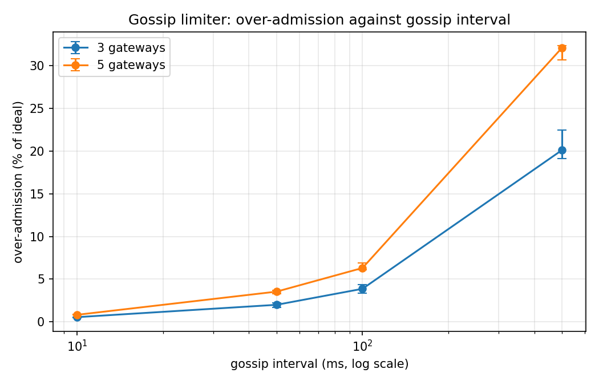
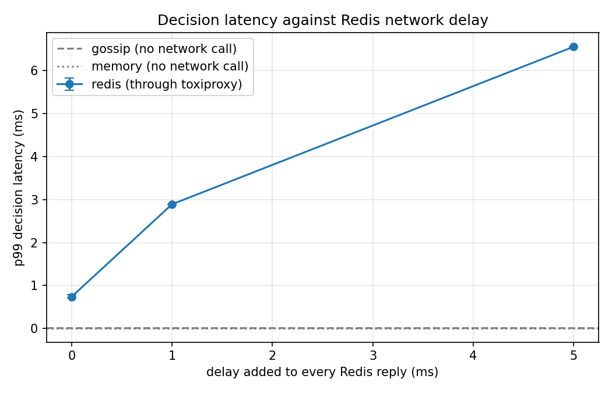

# Aegis: a distributed rate-limiting API gateway

Aegis is an HTTP gateway in Go that enforces per-client rate limits shared across several gateway instances. It shares the limit two ways behind one interface, and measures what each costs: **exactly**, with one Redis Lua script call per request, or **approximately**, with each gateway deciding from its own memory and gossiping its counts to the others.

## The result

Three gateways, offered twice the limit, median of 3 runs:

| Backend | Over-admission | p99 decision latency |
| --- | --- | --- |
| Redis + Lua (exact) | 0.00% | 395 µs |
| Gossip (approximate) | 4.45% | 12 µs |

Gossip decides about 33 times faster and lets about 4% more than the limit through. That error is adjustable: it falls to 0.54% when gateways gossip every 10 ms and rises to 20.1% at 500 ms.

| Gossip interval | 10 ms | 50 ms | 100 ms | 500 ms |
| --- | --- | --- | --- | --- |
| Over-admission, 3 gateways | 0.54% | 1.99% | 3.86% | 20.1% |
| Over-admission, 5 gateways | 0.82% | 3.53% | 6.30% | 32.1% |



Redis stays exact at 1, 3 and 5 gateways, but its decision time follows the network: p99 went from 0.74 ms to 2.9 ms to 6.6 ms as 0, 1 and 5 ms of delay were added between the gateways and Redis.



Under faults:

| Fault | Result |
| --- | --- |
| Redis down for 5 s, `fail_open` | 30.6% over-admission, no client errors |
| Redis down for 5 s, `fail_closed` | No over-admission, 27.7% of requests failed |
| Gossip cluster split 2 + 2 for 10 s | 33.4% over-admission |

All 13 scenarios are in [bench/results/RESULTS.md](bench/results/RESULTS.md), and the method, the model and its fit are in [docs/report.md](docs/report.md).

## Architecture

Every gateway runs the same binary and checks each request with the limiter before proxying it.

```text
                     +-----------------------+
                     |    Load generator     |
                     | round-robins requests |
                     +-----------+-----------+
                                 |
           +---------------------+---------------------+
           |                     |                     |
           v                     v                     v
  +-----------------+   +-----------------+   +-----------------+
  |    gateway 1    |<->|    gateway 2    |<->|    gateway 3    |
  | proxy + limiter |   | proxy + limiter |   | proxy + limiter |
  +--------+--------+   +--------+--------+   +--------+--------+
           |                     |                     |
           +----------+----------+----------+----------+
                      |                     |
                      v                     v
             +-----------------+   +-----------------+
             |      Redis      |   |    Upstream     |
             |   Lua scripts   |   |  echo service   |
             +-----------------+   +-----------------+

  <->   gossip backend: gateways exchange counters over UDP, Redis unused
  Redis is called only when the redis backend is selected
```

| Backend | How gateways share a limit | Algorithms |
| --- | --- | --- |
| `memory` | They do not; one gateway only | Token bucket, sliding window counter |
| `redis` | Each decision is one atomic Lua script in Redis | Token bucket, sliding window counter |
| `gossip` | Each gateway counts its own admissions and sends them to peers; a merge keeps the larger count | Sliding window counter |

## Quick start

You need Go (the version in `go.mod`) and Docker with Compose.

```
# one gateway, memory backend
docker compose -f deploy/docker-compose.yml up -d --build --wait upstream gateway
curl -i -H "X-API-Key: demo" http://localhost:8080/api/hello

# three gateways sharing one exact limit through Redis
LIMITER_BACKEND=redis docker compose -f deploy/docker-compose.yml up -d --build --wait --scale gateway=3

# send load: 200 requests per second for 30 s, one key, results to a CSV
docker compose -f deploy/docker-compose.yml run --rm loadgen -rate 200 -duration 30s -key k1 -out /results/raw/run.csv

# accuracy and latency of that run
go run ./cmd/analyze -in bench/results/raw/run.csv -scenario demo -backend redis -gateways 3

docker compose -f deploy/docker-compose.yml down
```

On PowerShell set the variable first: `$env:LIMITER_BACKEND = "redis"`. Use `gossip` in its place for the approximate backend.

| Port | What |
| --- | --- |
| 8080 to 8084 | Gateway replicas (proxy) |
| 9090 to 9094 | Gateway replicas (admin: `/healthz`, `/readyz`, `/metrics`, `/debug/limiter?key=`) |
| 8089 | Upstream echo service (port 8081 inside the Compose network) |
| 6379 | Redis |
| 9099, 3000 | Prometheus, Grafana (`--profile observability`) |

The observability stack is for local use only: Grafana allows anonymous viewing and its admin login is `admin`/`admin`. Do not publish these ports on a shared network.

## Reproduce a result

One command builds the image, starts a fresh cluster, runs the load, analyses it and tears the cluster down. This one reproduces the first row of the results table (S0, the noise floor) in about a minute:

```
go run ./cmd/bench -scenario S0 -reps 1 -summary bench/results/raw/my-summary.csv
go run ./cmd/bench -table -summary bench/results/raw/my-summary.csv
```

Expect over-admission and false rejects under 0.1% and a peak of about 1.05. Latencies depend on your machine. The `-summary` flag keeps your row out of the committed results file.

```
go run ./cmd/bench -scenario S1 -summary bench/results/raw/my-summary.csv    # the head-to-head: 6 runs, about 7 minutes
go run ./cmd/bench -scenario all -dry-run                                     # list every run without starting anything
python bench/plot.py                                                          # redraw the charts (needs matplotlib)
```

## Build and test

```
go build ./...
go vet ./...
go test ./...                       # unit tests
go test -race ./...                 # needs cgo; on Windows run it in Docker (see TASKS.md)
go test -tags integration ./...     # adds the Redis tests; starts Redis in Docker
```

## Limitations

- **Measured on one laptop.** The load generator, gateways, Redis and upstream share its CPUs, and Redis is a local hop. The comparisons hold; the absolute speeds would differ on real servers.
- **Coarse latency resolution.** Decision latency comes from a histogram whose buckets grow by 1.5×. The memory and gossip backends sit in its first bucket, under 10 µs.
- **The algorithm itself is approximate.** The sliding window counter admits up to about 1.05 times the limit in some one-second spans, on every backend including a single exact node.
- **Gossip trusts wall clocks.** Windows are numbered from each node's clock. Skew that is a large share of the window would misalign nodes; on one machine this cannot be seen.
- **Gossip has no token bucket,** and during a partition each side enforces the full limit alone.
- **Redis is a single point of failure.** While it is down the gateway either admits everything or rejects everything, by configuration.
- **Two scenarios run smaller than planned** (top load step 6×, burst 4×), because the laptop could not send the planned load on time.
- **No TLS, authentication or dynamic configuration.** Clients are identified by an unverified `X-API-Key` header or by IP address.

## Layout

| Path | What |
| --- | --- |
| `cmd/gateway` | The gateway |
| `cmd/upstream` | Dummy echo service |
| `cmd/loadgen` | Open-loop load generator |
| `cmd/analyze` | Accuracy and latency from a run's CSV |
| `cmd/bench` | Runs a scenario end to end |
| `internal/limiter` | The limiter contract and its three backends: `memory`, `redis`, `gossip` |
| `internal/proxy` | Reverse proxy and the middleware chain |
| `internal/config` | YAML, environment overrides, validation |
| `bench/` | Scenario matrix, chart script, results |
| `deploy/` | Compose file, gateway configs, Prometheus and Grafana |
| `docs/report.md` | The full write-up |
| `docs/notes/` | One design note per phase |
| `learnings/` | Notes explaining every part from the basics |
| [PLAN.md](PLAN.md), [TASKS.md](TASKS.md) | The design and the task tracker |
