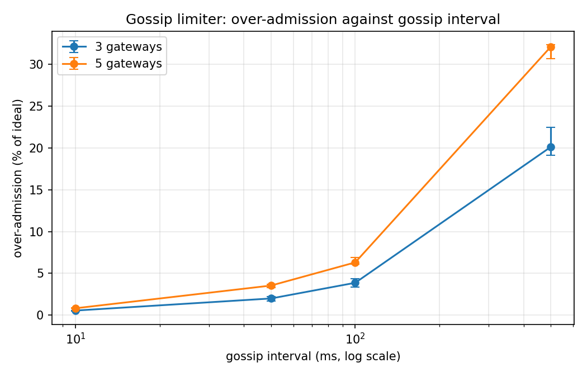
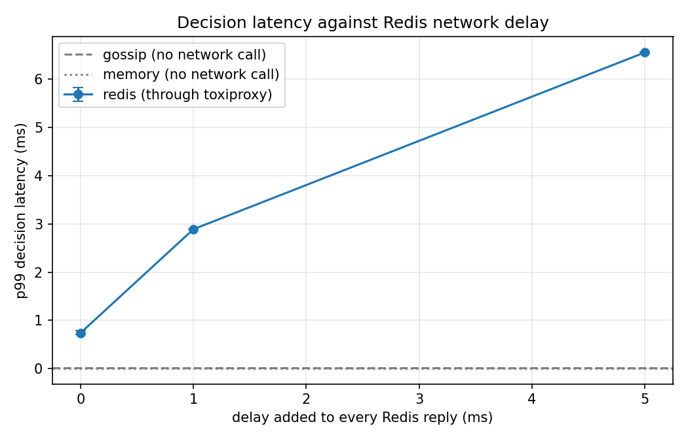

# Exact against approximate distributed rate limiting, measured

This report states what Aegis measured, how, and how far the numbers can be trusted. Every figure comes from a file in [bench/results/](../bench/results/); the last section says which.

## The question

Several gateways share one rate limit per client. They can share it exactly, by asking a central store on every request, or approximately, by deciding locally and telling each other afterwards. **How much over-admission does the approximate design accept in exchange for removing the network round trip from every request?**

## The answer in short

Three gateways, offered twice the limit, median of 3 runs (scenario S1):

| Backend | Over-admission | Decision latency p50 | Decision latency p99 |
| --- | --- | --- | --- |
| Redis + Lua (exact) | 0.00% | 149 µs | 395 µs |
| Gossip (approximate) | 4.45% (3.71 to 4.61) | 5 µs | 12 µs |

- Gossip decides about 33 times faster at p99 and admits about 4% more than the limit.
- The 4% is adjustable. At a gossip interval of 10 ms it is 0.54%; at 500 ms it is 20.1%.
- A simple staleness model predicts the gossip figures at 3 gateways to within the run-to-run spread, once one correction is made (see "Prediction against measurement").
- On one laptop the whole-request difference is small: client p99 was 1.92 ms with Redis and 1.71 ms with gossip. Redis sat on the same machine. Scenario S6 shows the gap widening as Redis moves further away.

## Setup

| Item | Value |
| --- | --- |
| Machine | One laptop, 12th Gen Intel Core i7-12700H, Docker |
| CPU limits | 1 CPU per gateway, 2 for the load generator |
| Gateway | One Go binary; backend chosen by `LIMITER_BACKEND` |
| Exact backend | Redis 7.4; each decision is one Lua script call, with a 50 ms deadline |
| Approximate backend | Per-node grow-only counters, merged by keeping the larger count; sent over UDP through hashicorp/memberlist every gossip interval to `fanout` random peers |
| Algorithm | Sliding window counter, 100 requests per second per key, on every backend |
| Upstream | An echo service in the same Compose network |

Defaults for every scenario unless it says otherwise: 3 gateways, 10 keys with uniform traffic, 2,000 requests per second offered (twice the total limit of 1,000), gossip every 100 ms with fanout 2, 30 s measured after a 5 s warm-up, 3 repetitions.

## Method

- **Open-loop load.** The load generator sends on a fixed schedule and does not wait for replies, so a slow gateway cannot reduce the load it is tested with. A request that leaves more than 5 ms behind schedule is counted as a late send.
- **Accuracy by replay.** Each run's own request log is replayed through one single-node limiter with a fake clock set to each send time. What that reference admits in the measured window is the ideal count. Over-admission is `max(0, admitted − ideal) / ideal`; false rejects are `max(0, ideal − admitted) / ideal`.
- **Peak check.** The most requests admitted for one key in any one-second span, divided by the limit.
- **Decision latency** is the time inside the limiter call, from each gateway's histogram, summed over gateways. Only the measured window is counted: the gateways are scraped when the warm-up ends and again after the load, and the first scrape is subtracted.
- **Repetition.** Each point runs 3 times on a fresh cluster. Tables give the median, with the lowest and highest run in brackets.
- **Sizing.** If more than 1% of sends are late, the laptop could not sustain the run, and the rate is lowered.
- **Refused runs.** The runner does not record a run in which at least 90% of requests failed in the limiter, or in which gossip nodes merged nothing from each other. Both mean the cluster was broken, not slow.

One command runs a scenario from a clean start to a summary row: `go run ./cmd/bench -scenario S1`.

## Results by scenario

The full table, with ranges and every column, is [bench/results/RESULTS.md](../bench/results/RESULTS.md).

### S0: how noisy is the measurement?

One gateway on the single-node memory backend, which is exact. Any error reported is the measurement's own.

- Over-admission: 0.00% to 0.01%. False rejects: at most 0.03%.
- Peak in one second: 1.05 times the limit on all three runs.

The noise floor is under 0.04%, so differences of a few percent between backends are real. The 1.05 peak belongs to the algorithm: the sliding window counter assumes the previous window's requests were evenly spread. Every backend shares it, so peaks below are read against 1.05.

### S1: head to head

The table at the top. Redis admitted 29,624 to 29,642 requests against an ideal of 29,633 to 29,646. Gossip admitted 30,737 to 31,008 against an ideal of 29,637 to 29,643.

### S2: cluster size

| Gateways | Redis over-admission | Gossip over-admission | Redis decision p99 | Gossip decision p99 |
| --- | --- | --- | --- | --- |
| 1 | 0.00% | 0.00% | 371 µs | 10 µs |
| 3 | 0.00% | 3.74% | 377 µs | 11 µs |
| 5 | 0.00% | 7.07% | 382 µs | 12 µs |

Redis is exact at every size. Gossip with one gateway is exact too, since there is nobody to be out of date about, and its error grows with each gateway added.

### S3: offered load

| Load against the limit | Redis over-admission | Gossip over-admission | Redis decision p99 |
| --- | --- | --- | --- |
| 0.5× | 0.00% | 0.00% | 379 µs |
| 1× | 0.00% | 1.41% | 369 µs |
| 2× | 0.00% | 3.83% | 836 µs |
| 6× | 0.03% | 5.08% (4.87 to 7.68) | 6,561 µs |

- Below the limit the two backends behave the same: nothing is over-admitted and nothing is falsely rejected.
- Redis decision latency rises steeply with load: every request, admitted or not, costs a round trip.
- Gossip decision latency stays at 10 to 12 µs at every load.
- The plan's top step was 10×. At 10,000 requests per second 1.0% to 2.3% of sends were late (median 1.8%), so the step was lowered to 6×, where late sends were 0.3% to 0.8%.

### S4: gossip interval (chart 1)



| Interval | 3 gateways | 5 gateways | Gossip traffic per node (3 gateways) |
| --- | --- | --- | --- |
| 10 ms | 0.54% | 0.82% | 138 kB/s |
| 50 ms | 1.99% | 3.53% | 42 kB/s |
| 100 ms | 3.86% | 6.30% | 24 kB/s |
| 500 ms | 20.1% | 32.1% | 6.8 kB/s |

Over-admission grows with the interval, close to linearly. Going from 100 ms to 10 ms cuts the error about 7-fold and costs about 5.8 times the gossip traffic.

### S5: fanout

Five gateways, 100 ms interval.

| Fanout | Over-admission | Gossip traffic per node |
| --- | --- | --- |
| 1 | 12.8% | 17 kB/s |
| 2 | 6.86% | 38 kB/s |
| 4 | 4.97% | 76 kB/s |

Each doubling of fanout doubles the traffic. The first doubling nearly halves the error; the second removes about a quarter more.

### S6: Redis network delay (chart 2)



Redis traffic went through toxiproxy at every point, including 0 ms, so the proxy's own cost is in all three.

| Delay added | Decision p99 | Client p99 | Over-admission |
| --- | --- | --- | --- |
| 0 ms | 738 µs | 1.96 ms | 0.00% |
| 1 ms | 2,889 µs | 3.92 ms | 0.00% |
| 5 ms | 6,554 µs | 7.81 ms | 0.01% |

Redis stays exact, and its latency follows the network. Gossip has no such dependence: its decision p99 was 10 to 15 µs at every point in the matrix. Passing through toxiproxy with no delay already costs something: 738 µs here against 395 µs in S1.

### S7: burst from idle

Five seconds of silence, then 4 times the limit for one second, which is the whole measured window.

| Backend | Over-admission | Peak in one second |
| --- | --- | --- |
| Redis | 0.06% (0.00 to 5.90) | 1.52 (1.14 to 1.61) |
| Gossip | 4.81% (4.19 to 6.38) | 1.45 (1.21 to 1.90) |

Gossip's worst case in theory is every gateway admitting the full limit before any gossip arrives: 3 times the limit. The worst run measured 1.90. The Redis run that shows 5.90% had 6.7% late sends, so its figure is the measurement failing, not Redis. The plan's burst was 10×; from cold the laptop sent 22% to 45% of that late.

### S8: skewed keys

1,000 keys with a Zipf distribution.

- Redis: 0.00% over-admission, decision p99 842 µs.
- Gossip: 0.59% over-admission, decision p99 10 µs, but 189 kB/s of gossip per node, 8 times the default scenario's 23 kB/s.

Gossip's error is lower than with 10 uniform keys, and its traffic is higher: it sends every key that changed, and here many more keys change.

### S9: throughput ceiling

Single runs, not medians. Client p99 in milliseconds:

| Total rate | Memory (1 gateway) | Redis (3 gateways) | Gossip (3 gateways) |
| --- | --- | --- | --- |
| 2,000 req/s | 2.00 | 2.27 | 2.04 |
| 4,000 req/s | 27.6 | 14.4 | 1.75 |
| 8,000 req/s | 50.2 | 38.2 | 27.7 |
| 16,000 req/s | collapse | collapse | collapse |

By the plan's rule (the rate at which p99 doubles), the ceiling per gateway is between 670 and 1,330 requests per second with Redis, and between 1,330 and 2,670 with gossip. The single memory gateway, with all the traffic on its one CPU, passed its ceiling between 2,000 and 4,000. At 16,000 every backend failed 75% to 96% of requests: that is the laptop, which also runs the load generator. Redis decision p99 climbed from 641 µs to 7,118 µs between 2,000 and 8,000 requests per second, while gossip's stayed at 10 µs.

### F1: one gateway killed at 10 s

- About 27% of requests failed at the client under both backends: the ones sent to the dead gateway.
- The survivors kept limiting. Redis: 0.00% over-admission (0.00 to 0.57). Gossip: 1.57% (1.43 to 2.65).
- Late sends were 1.3% to 9.9%, because requests to the dead gateway piled up in the load generator. These accuracy figures are less reliable than the rest.

### F2: Redis stopped for 5 s

| Policy | Over-admission | Requests failed | Decision p99 |
| --- | --- | --- | --- |
| `fail_open` | 30.6% | 0.00% | 74 ms |
| `fail_closed` | 0.00% | 27.7% | 74 ms |

The exact backend has a single point of failure, and the policy only chooses which way it fails. In the earlier Phase 2 outage check, gateways under both policies resumed deciding when Redis returned, with nothing restarted.

### F3: gossip cluster split 2 + 2 for 10 s

33.4% over-admission (33.0 to 33.9) and a peak of 2.15 times the limit. For those 10 seconds each half enforced the full limit alone, so the cluster admitted twice the limit: 10 of 30 seconds at double is one third over.

## Prediction against measurement

### The plan's first-order model

A gateway's view of its peers lags by about half a gossip interval. What the peers admitted during that lag is invisible to it. The plan predicted:

```text
over-admission ≈ p = ((N − 1) / N) × lag / W        lag = interval / 2, W = 1 s
```

### One correction

The model counts the hidden requests as a share of the limit. But the peers are admitting at the *actual* rate, which is already above the limit by the over-admission itself. Writing `x` for the over-admission:

```text
x = p × (1 + x)      so      x = p / (1 − p)
```

For small `p` the two are the same. At a 500 ms interval they are not.

### Three gateways, where fanout 2 reaches every peer

| Interval | First-order `p` | Corrected `p / (1 − p)` | Measured (range) | Lag the measurement implies |
| --- | --- | --- | --- | --- |
| 10 ms | 0.33% | 0.33% | 0.54% (0.49 to 0.54) | 8 ms |
| 50 ms | 1.67% | 1.69% | 1.99% (1.71 to 2.20) | 29 ms |
| 100 ms | 3.33% | 3.45% | 3.86% (3.34 to 4.33) | 56 ms |
| 500 ms | 16.7% | 20.0% | 20.1% (19.1 to 22.5) | 251 ms |

The last column turns the measurement back into a lag: `lag = (x / (1 + x)) × (N / (N − 1)) × W`.

- **The corrected model fits.** At 500 ms it predicts 20.0% against a measured 20.1%; the first-order form says 16.7%.
- **The implied lag is half the interval plus 1 to 6 ms.** That is the size expected of delivery and processing time, which the model leaves out. At 10 ms those few milliseconds are a large share of the lag, which is why the relative miss is biggest there (0.33% against 0.54%).
- **The fit is no tighter than the noise.** At 100 ms the three runs imply lags of 48 to 62 ms. Four points cannot separate "a constant few milliseconds" from other small effects.

### Five gateways, where fanout 2 reaches half the peers

| Interval | Corrected model | Measured | Implied lag | Lag as a share of the interval |
| --- | --- | --- | --- | --- |
| 10 ms | 0.40% | 0.82% | 10 ms | 1.0 |
| 50 ms | 2.04% | 3.53% | 43 ms | 0.85 |
| 100 ms | 4.17% | 6.30% | 74 ms | 0.74 |
| 500 ms | 25.0% | 32.1% | 304 ms | 0.61 |

The model is well under at every interval. Its assumption that each round reaches every peer no longer holds: news reaches the other two peers second-hand. S5 tests this directly at 100 ms:

| Fanout | Measured | Implied lag |
| --- | --- | --- |
| 4 (every peer) | 4.97% | 59 ms |
| 2 | 6.86% | 80 ms |
| 1 | 12.8% | 142 ms |

With fanout 4 the implied lag is 59 ms, in line with the 56 ms found at 3 gateways. So the model holds when its assumption does, and the lag grows as fanout shrinks, as the plan's "known limits" said it would. The share-of-interval column falls from 1.0 to 0.61 as the interval grows; this report has no tested explanation for that.

### What the model does not cover

- **Load.** The model says over-admission does not depend on how far above the limit the load is. Measured: 3.83% at 2× and 5.08% at 6×. At 6× the machine was close to its ceiling (client p99 of 12.8 ms against 2.2 ms), so late gossip is a possible cause, but that was not tested.
- **Repeatability.** The default gossip configuration was measured in four scenarios (S1, S2, S3, S4), 12 runs in all. They range from 3.13% to 4.61%, with medians from 3.74% to 4.45%. A difference of half a point between two gossip results is within that spread.

## Coordination cost

| Backend | Cost per request | Background cost |
| --- | --- | --- |
| Redis | One script call | None |
| Gossip | None | 23 kB/s sent per node at the defaults; 37 kB/s at 5 gateways |

Redis operations were not read from Redis `INFO`; at one script call per request the rate equals the offered load. Gossip traffic grows with the number of keys that change, the fanout and the gossip rate, and does not grow with the request rate: it was 22 to 24 kB/s per node from 0.5× to 6× load.

## Limitations

- **One laptop.** The load generator, the gateways, Redis and the upstream share one machine's CPUs. Relative differences are meaningful; absolute speeds are not. Redis in particular is far closer here than it would be in a deployment.
- **Coarse latency buckets.** Histogram buckets grow by 1.5×, so a p99 is known only to within its bucket. The memory and gossip backends both sit in the first bucket, under 10 µs.
- **Three runs per point,** and single runs for S9.
- **Shared clock.** Gossip numbers windows by each node's wall clock. On one machine the clocks agree. Across machines, skew that is a large part of the window would misalign them, and this was not measured.
- **One algorithm.** The gossip backend implements only the sliding window counter. The token bucket runs on the memory and Redis backends.
- **Lowered sizes.** S3's top step and S7's burst are smaller than planned. The six runs at the planned sizes are kept in `bench/results/summary-oversized.csv` and are not used here.
- **Less reliable rows.** F1 (1.3% to 9.9% late sends) and one of the three S7 Redis runs (6.7%).
- **Send time stands in for arrival time** in the replay. S0 bounds the error this causes at 0.04%.

## What would change next

- Run the load generator and Redis on separate machines, so that absolute latencies mean something and clock skew can be measured.
- More repetitions at the points the model is tested against, and intervals between 100 and 500 ms, to pin down the extra lag.
- Finer histogram buckets below 100 µs.
- Measure the load dependence of gossip over-admission with spare CPU, to see whether the rise at 6× is real.
- Gossip counts as soon as they change by some amount, not only on a timer, to cut the lag where it matters most.

## Where each number comes from

| Numbers | File |
| --- | --- |
| Every scenario figure (S0 to S9, F1 to F3): medians and ranges | `bench/results/summary.csv`, shown as a table in `bench/results/RESULTS.md` |
| Decision p50, gossip traffic per node, limiter errors | The `note` column of `bench/results/summary.csv` |
| Late sends at the planned sizes (1.0% to 2.3%; 22% to 45%) | `bench/results/summary-oversized.csv` (`late_sends` over `requests`) |
| Recovery after a Redis outage | `bench/results/phase2-redis-cluster.txt` |
| Both charts | Drawn from `summary.csv` by `bench/plot.py` |
| Model predictions and implied lags | Computed from the medians above with the formulas in this report |
